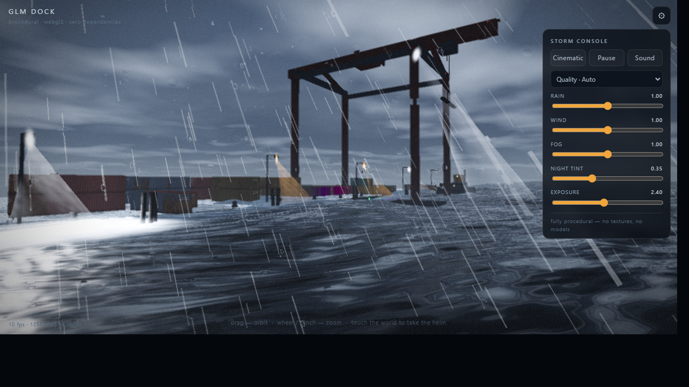

# GLM Dock — a fully procedural rainy night

A moody, rainy shipping dock rendered with a **from-scratch WebGL2 engine** — no Three.js,
no Babylon, no libraries, no asset files. Every mesh, texture, light, wave and raindrop is
generated in code at runtime.



 

## Run locally

```bash
python -m http.server 8000
# open http://localhost:8000
```

Any static file server works (`npx serve`, VS Code Live Server, nginx…).

## Deploy to GitHub Pages

1. Push this repo to GitHub.
2. Repo → **Settings → Pages → Build and deployment → Deploy from a branch**.
3. Select the `main` branch and `/ (root)` folder, save.
4. The page goes live at `https://<user>.github.io/<repo>/` — index.html sits at the root,
   everything is relative, zero build step.

## Controls

- **Drag** — orbit · **wheel / pinch** — zoom · any touch of the scene takes the camera from the
  automatic cinematic mode.
- **⚙ Storm console** (top right): rain, wind, fog, night tint, exposure, quality presets,
  cinematic / pause / sound toggles.
- Dev tip: pin the camera with a URL, e.g. `?eye=-80,4.5,42&look=12,9,-18&fov=55`.

## What's inside

| Piece | How it's done |
|---|---|
| Engine | hand-rolled mat4/vec3 math, shader/VAO/FBO wrappers, forward HDR pipeline |
| Sky | fbm storm clouds, moon glow + disc, sparse stars, lightning flashes |
| Sea | 6-octave Gerstner waves, analytic normals, wind-sheared micro ripples, foam at wall/pilings/crests, GGX moon path + per-light pillars |
| Wet dock | half-res planar reflection pass (mirrored camera), puddle mask, procedural raindrop ripples, blurred multi-tap sampling |
| Rain | camera-space instanced streaks catching lamplight, ground splash rings |
| Lights | damped-pendulum swaying lamps, sodium flicker, glow billboards, volumetric cones |
| Props | instanced corrugated containers with rust + stencil codes (runtime canvas texture), gantry crane, moored barge bobbing on the swell, pilings, bollards |
| Post | bloom → ACES tonemap → lens droplets → FXAA → vignette → film grain |
| Audio | WebAudio synthesis only: rain hiss, sea swell, lamp hum, rolling thunder (starts muted) |

No textures ship with the repo — container codes are drawn to a canvas at boot, everything
else is math.

## Files

```
index.html                 page + storm console UI
src/main.js                boot + UI wiring + loop
src/render.js              pass orchestration (reflection → scene → post)
src/camera.js              cinematic shots + mouse/touch orbit
src/audio.js               synthesized ambience
src/engine/                math, gl helpers, GLSL library, post, geometry
src/scene/                 sky, sea, dock, props, rain, lights
```
